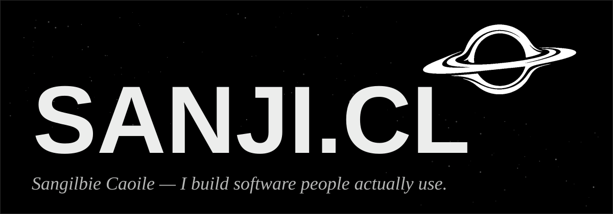

I'm Sangilbie Caoile, a fourth-year Computer Science student at the University of
Makati. I build the unglamorous parts well: a transit guide that works with no
connection, ticketing and attendance for campus events, a photobooth that keeps
running when the Wi-Fi doesn't. I like backends that stay quiet and interfaces that
feel obvious.

Twelve projects, four awards and three credentials are on
[sanji-cl.vercel.app](https://sanji-cl.vercel.app). Six of them are here.

## Projects

### KomyutPH

*2026 – present, thesis. Technical documentation lead and the travel-time model, team of 4.*

A crowdsourced map and router for informal transit — jeepneys, tricycles, UV
Express, buses and rail — across Taguig, Makati and Pateros. Trips record GPS
offline, a Python pipeline map-matches them, clusters stops and predicts travel
times, and the API keeps routes, fares and city route packs in PostGIS.

`React Native` `Expo` `NestJS` `PostgreSQL` `PostGIS` `Redis` `FastAPI`

### SIC App

*October 2026. Backend developer, team of 3.*

An operations console for the student organisation: publish events, import attendees
from CSV, issue signed QR tickets scanned at the door, and send segmented email
campaigns with per-recipient delivery tracking. An asset library, CSV exports and a
QR short-link generator sit alongside. It served 80+ students.

`Next.js` `React` `Tailwind CSS` `Prisma` `Neon`

### SilangApp

*September to December 2025. Full-stack across the API and both clients, team of 4.*

A barangay platform for Barangay Silangan in Pateros: verified resident accounts,
document requests, complaints, announcements, event check-in, business listings and
chat with officials — two mobile apps and a desktop portal, gated by eight roles.
The API adds refresh-token rotation, notifications and uploads.

`React Native` `React` `NestJS` `Prisma` `PostgreSQL` `Socket.io`

### Inventrix

*October to November 2025. Full-stack, from the JPA model and services to the FreeMarker screens, team of 3.*

A server-rendered inventory and order system: products, categories, suppliers and
warehouses; purchase and sales orders with line items; stock movements and transfers
between warehouses; low-stock alerts, an audit log, and financial, purchase and stock
reports. Roles gate the console and seeded data fills it.

`Java` `Spring Boot` `Hibernate` `MySQL`

### Maki

*October 2026. Lead developer on the pre-development documents and the citation-backed chat, team of 4.*

A zero-login admissions assistant for the University of Makati that answers only from
four bundled source documents — scholarships, requirements, campus map and offices —
and verifies every citation server-side. The interface adds journey cards, follow-up
prompts and a citation viewer that opens the original page of the PDF.

`React` `Vite` `Tailwind CSS` `FastAPI`

### AiKareer

*September to December 2024. Backend and the AI layer, team of 4.*

An AI career assistant: a Gemini-backed chatbot with per-user history, a multi-part
assessment that returns feedback and a skill-gap analysis, and a résumé builder that
exports PDF. Accounts cover email verification and OTP password reset.

`ASP.NET Core` `C#` `MongoDB` `Gemini API`

The rest: **KokoMyut** (offline transit), **SIC Photobooth** (events), **Smart Recall**
(studying), **Muntinlupa UPA** (city services), **TamboLink** (barangay services) and
**JL Mart** (e-commerce). Earlier work includes AR Kingdom Defense, a tower-defence
game in Unity.

---

## Experience

**Backend Developer**, Society of Innovative Computing, Dev Team

*August 2026 – present*

Backend for the organisation's event tools: authentication and admin guards, attendee
registries, QR ticketing and an offline-first print pipeline.

**Full-Stack Developer**, independent practice

*November 2024 – present*

Client work, all remote: inventory and sales tracking, paperless applications,
incident reporting and an AI study tool, scoped and shipped end to end.

---

## Toolkit

| Group | Every day | When needed |
| --- | --- | --- |
| Languages | TypeScript, JavaScript, Python | Java, HTML/CSS, PHP, C# |
| Frameworks | React Native, React, Next.js, NestJS, Vite | Spring Boot, ASP.NET Core, FastAPI, Fastify |
| Data | PostgreSQL, Prisma, SQLite | PostGIS, MySQL, MongoDB, Hibernate, Redis |
| Cloud and tools | Git, Vercel | Neon, Render, Gemini API, Supabase |

---

## Credentials

**IT Specialist – Databases**

*Pearson, November 2026. [Verify](https://www.certiport.com/portal/Pages/CredentialVerification.aspx)*

**Confluent Certified Data Streaming Engineer Foundations**

*Confluent, an IBM Company, September 2026. [Verify](https://training.confluent.io/certification/verify)*

**Global MOOC on the Ethics of AI**

*LG AI Research, August 2026. [Verify](https://www.coursera.org/account/accomplishments/verify/G9AS0DMUYH1P)*

---

## Awards

**1st Runner Up** — InfoTechnolympics 2026, hackathon category. Best in UI and UX,
for Maki.

**Champion** — InfoTechnolympics 2025, C# category. A timed problem-solving race.

**Finalist** — Zero Vector Ventures, Stage 0: Build Nothing, Prove Everything V3.
Top 6 of 15 teams.

**Dean's Lister** — University of Makati, 2023 – 2026.

---

## Contact

*Building something? Tell me what it has to do.*

- [sangilbie@gmail.com](mailto:sangilbie@gmail.com)
- [sanji-cl.vercel.app](https://sanji-cl.vercel.app)
- [github.com/scaoile](https://github.com/scaoile)
- [linkedin.com/in/sangilbie-caoile](https://www.linkedin.com/in/sangilbie-caoile-61088b39b/)
- [instagram.com/sanji.cl](https://instagram.com/sanji.cl)
- [résumé, PDF](https://sanji-cl.vercel.app/resume.pdf)
